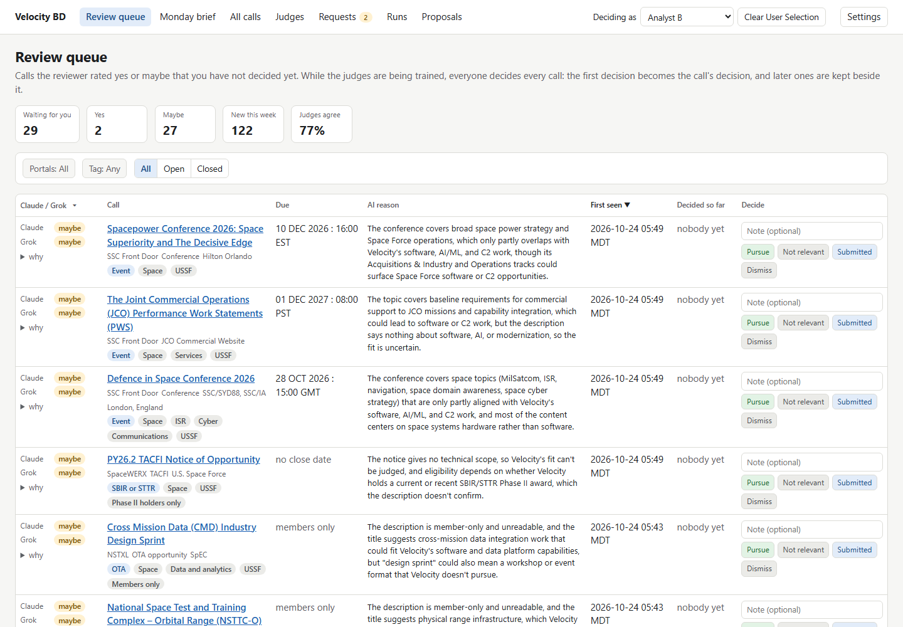
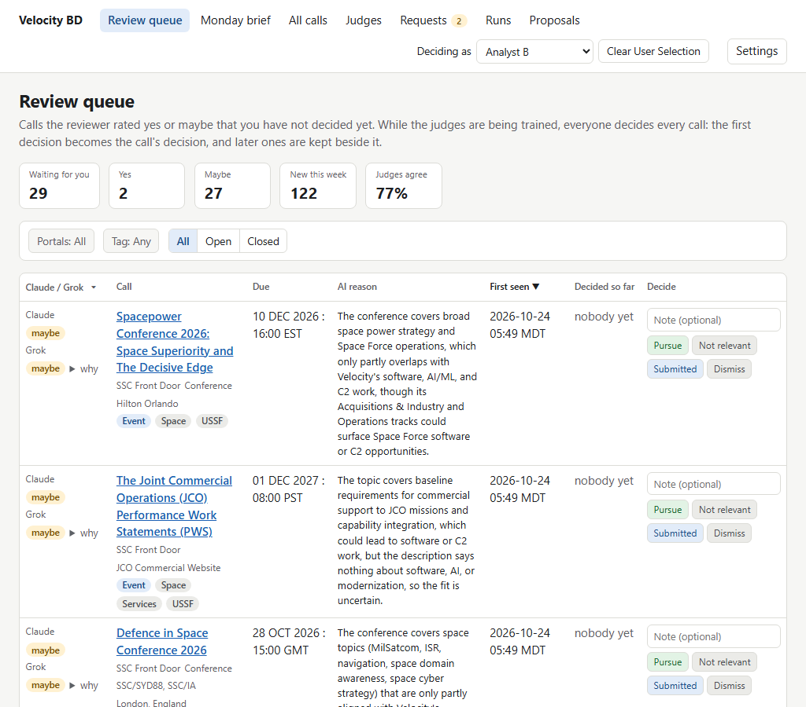
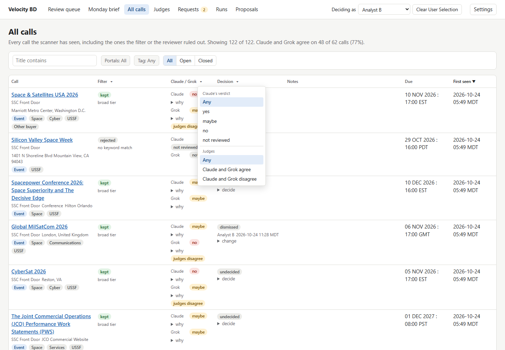
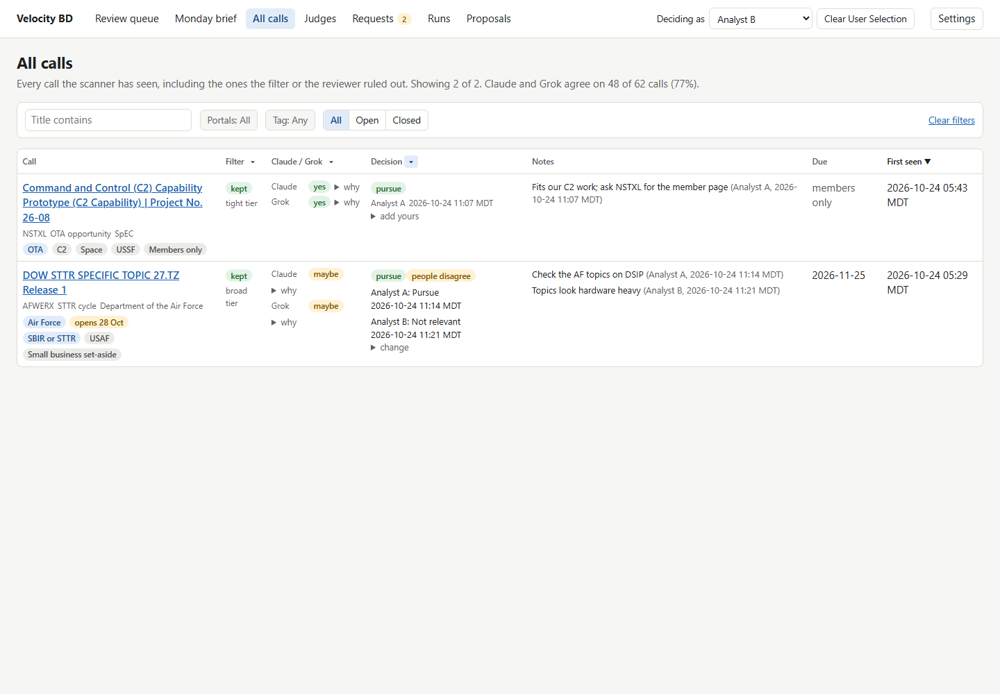
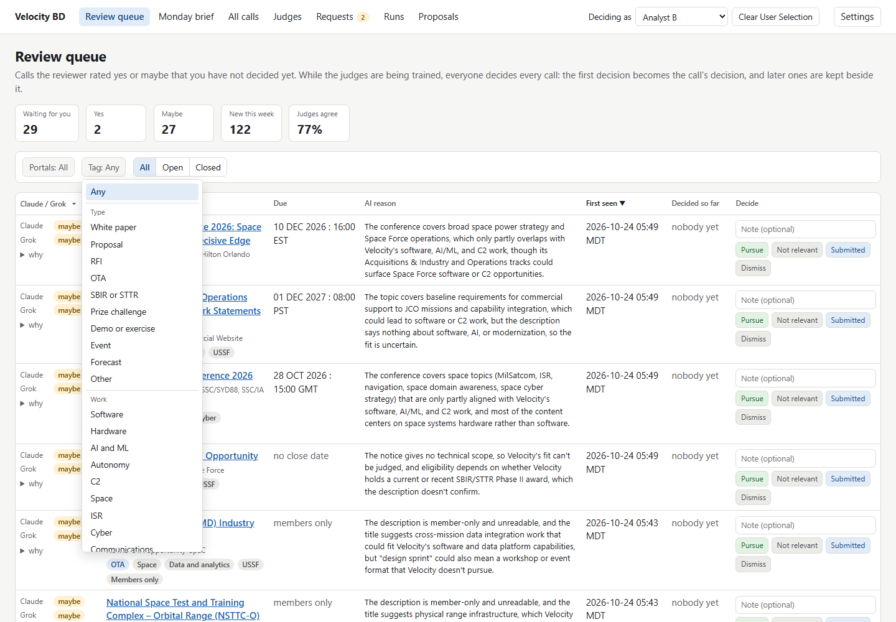
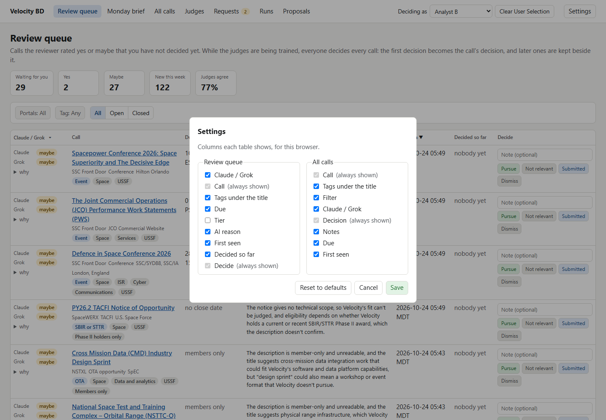
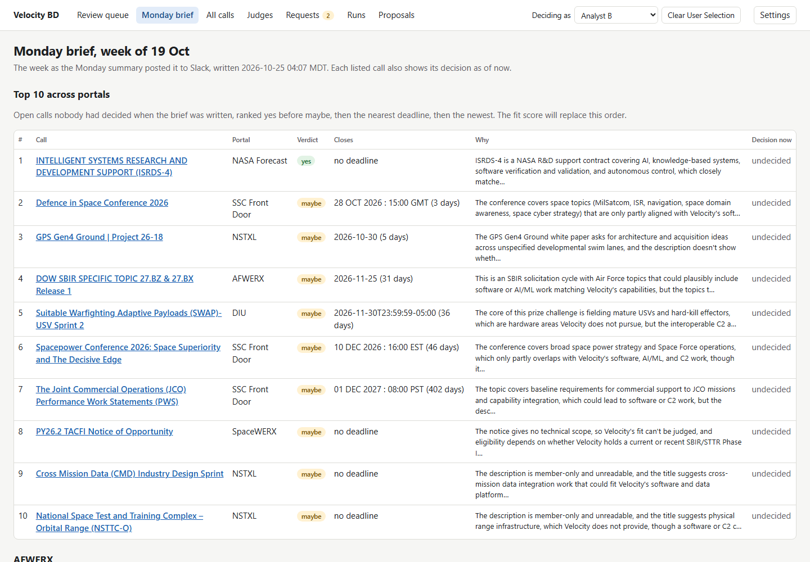
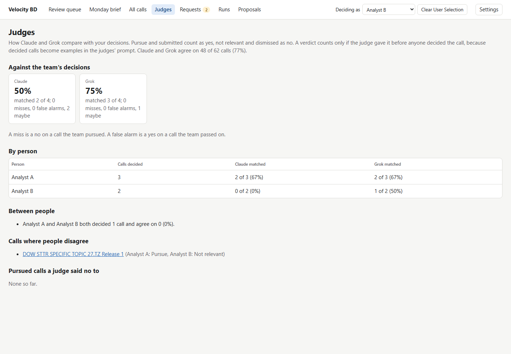
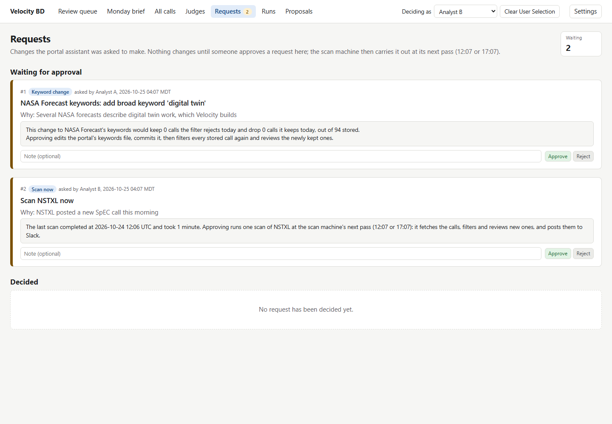
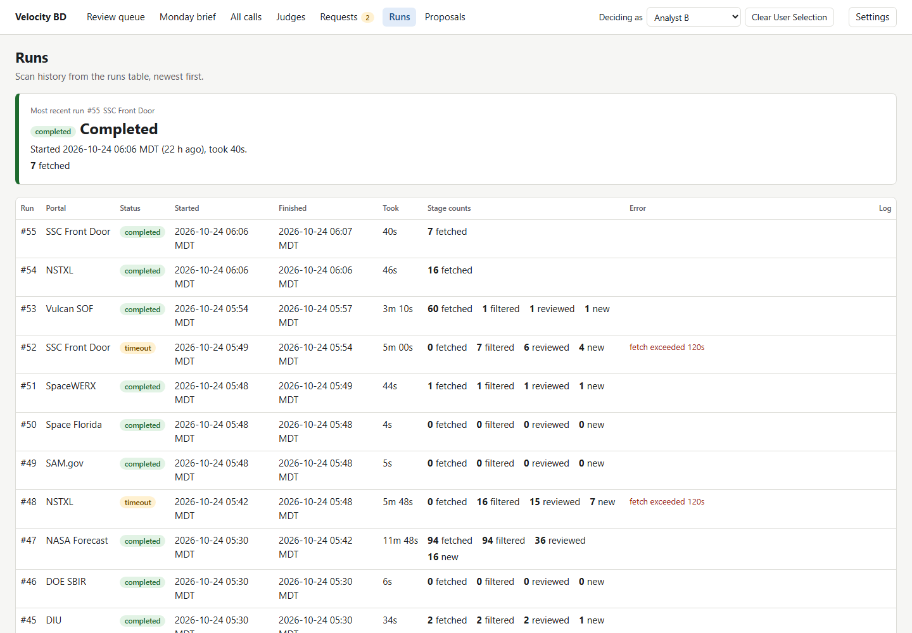

# BD dashboard snapshot, 25 October 2026

A working copy of the triage dashboard the BD team uses today, for redesigning it in the Velocity Theme. Every page keeps its real markup and styling; read it beside the [design spec](../dashboard-design-spec.md), which lists every requirement and decision.

- Public data only. The 122 calls come from the public portals (NASA Forecast, NSTXL, SSC Front Door, AFWERX, DIU, SpaceWERX). Vulcan SOF's calls are left out because its pages sit behind a login.
- Samples. The decisions by Analyst A and Analyst B, the two proposals and the two change requests are samples, there to show decided and waiting states.
- Static. Opened in a browser, links between pages work, the filter and header menus open, and Settings opens its dialog; buttons and forms save nothing. GitHub shows the pages as source, so the screenshots below show them rendered.

## The seven pages

These are the pages from before the 26 Oct restructure; the spec's Pages section gives each its new place. Home replaces the Monday brief, Calls holds the review queue (as To review) and All calls, Proposals holds Pursuing, Submitted and Results (this Proposals page), and Automation holds Requests, Scans (this Runs page) and Judges.

| Page | Path | What it is for |
| --- | --- | --- |
| [Review queue](queue.html) | `/` | Triage: decide each call the judges rated yes or maybe. Seen as Analyst B. |
| [All calls](calls.html) | `/calls` | Every call, the filter's rejects too, with votes, notes and the change control. |
| [Monday brief](brief.html) | `/brief` | The week's Top 10 across portals, then a bulletin board per portal. |
| [Judges](judges.html) | `/judges` | How Claude and Grok compare with each person's decisions. |
| [Requests](requests.html) | `/requests` | The portal assistant's change requests waiting for approval. |
| [Runs](runs.html) | `/runs` | Scan history: status, duration and stage counts per run. |
| [Proposals](proposals.html) | `/proposals` | Past submissions and win rate by portal. |

## Screens

Review queue at 1440px: metric cards, the filter bar, then rows with both judges' verdicts, details, tags, Claude's reason and the decide buttons.

Review queue at 1024px, the narrowest tested width: every column still fits and text wraps.

A header filter: the Claude / Grok menu filters Claude's verdict and whether the judges agree. Due is sorted, closing soonest.

Votes: pursued calls, one carrying both analysts' decisions and the people disagree flag.

The Tag menu: Any, then the tags grouped as Type, Work, Customer and Access.

Settings: column choices per table, kept for this browser; Call and Decide always show.

Monday brief: the Top 10 across portals and each portal's week.

Judges: each judge against the team, per person, and between people.

Requests: two sample requests waiting, each with its preview and Approve or Reject.

Runs: the latest scan on top, then the history.

